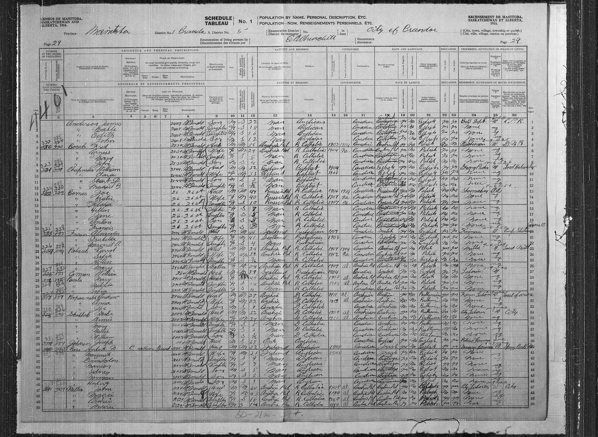
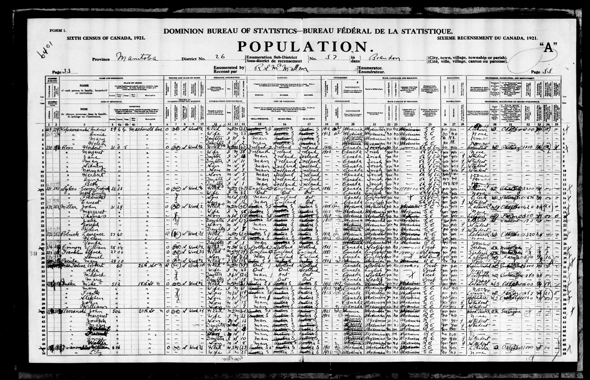
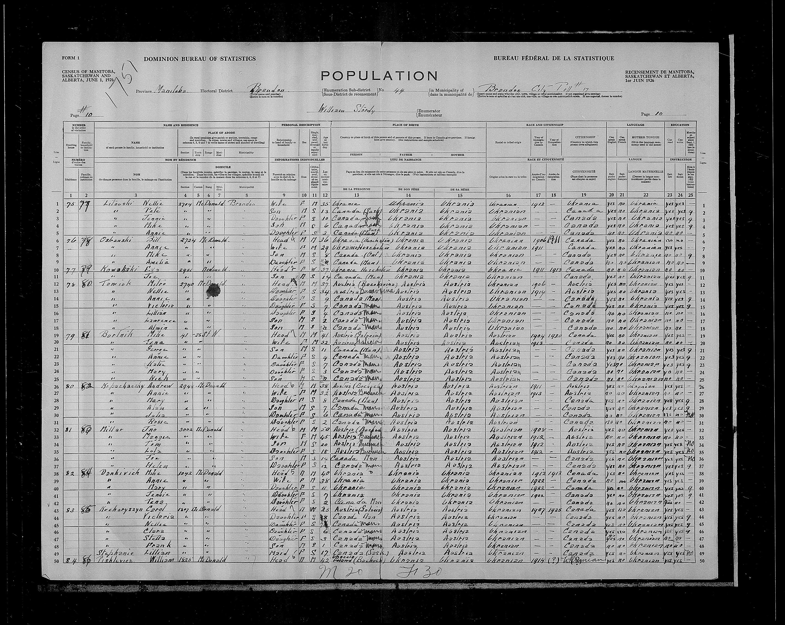

+++
title = 'Kopochinski'
date = 2024-12-24T17:02:22-07:00
draft = false
+++


```
Lines 31-35
Andrew and Annie Kopacnski
    Address: 2944 McDonald Ave. Brandon, Manitoba
    Age: 27 and 22
    Nativity: Austria
    Immigrated: 1911 and 1913
    Religion: Greek Catholic
    Ethnicity: Ruthenian
    Language: Ruthenian
    Profession: Teamster and none
```


```
Line 1
Andrew and Annie Kopaczanski
    Address: 2944 Macdonald Ave. Brandon, Manitoba
    Age: 33 and 25
    Nativity: Galicia
    Immigrated: 1912 and 1913
    Nationality: Ukrainian
    Ethnicity: Ukrainian
    Language: Ukrainian
    Religion: Greek Catholic
    Profession: Labourer and none
```


```
Lines 26-31
Andrew and Annie Kopachansky
    Address: 2924 McDonald Ave. Brandon, Manitoba
    Age: 38 and 32
    Nativity: Austria
    Immigrated: 1911 and 1912
    Ethnicity: Austrian
    Language: Ukrainian
```

## References
1. https://recherche-collection-search.bac-lac.gc.ca/eng/Home/Record?app=census&IdNumber=66983745&ecopy=e002879985
